# sshd-cli - Simplify Termux to install sshd


[-purple.svg)](https://github.com/cloudgen/ciao)
[](https://github.com/cloudgen/sshd-cli)

**sshd-cli** makes it simple on **Termux** to install and run OpenSSH **sshd**. One program, one login, no systemd.

| You | The other role | Not this |
|-----|----------------|----------|
| A Termux login that wants SSH *into* this phone | OpenSSH `sshd` and its files under `$PREFIX/etc/ssh` | A systemd unit editor, a `termux-services` wrapper, a `sudo` wrapper, or an SSH session mux / ProxyJump helper |

| Includes | Excludes |
|----------|----------|
| Install this helper, then start sshd as a **background daemon** (Termux often listens on **8022**) | Wrapping `sudo` inside the CLI; systemd / termux-services / cron-as-service |
| Host keys and this login’s `authorized_keys` | Dropbear-only hosts; wrapping `apt` on Linux; firewall changes; a Termux:Boot installer |
| This login’s `~/.ssh/config` Host list (`dns`); `ssh` / `download` using those Host aliases | `/etc/hosts`; `Host *`; SSH session mux |

| Step | What it means | What you type |
|------|---------------|---------------|
| Install the helper | Puts `sshd-cli` on your PATH so later sshd steps are one command. | `curl -fsSL https://raw.githubusercontent.com/cloudgen/sshd-cli/main/sshd-cli \| sh` |
| Install OpenSSH on Termux | Termux does not ship `sshd` until you ask. | `sshd-cli install` (runs `pkg install openssh termux-auth`) |
| Start sshd | OpenSSH **forks itself** so a laptop can connect. Default Termux port is often **8022**. This is not a boot service. | `sshd-cli start` then `ssh -p 8022 user@host` |
| After a reboot | The daemon is gone. Start again. Termux:Boot is **your** hook if you want listen-after-reboot. | `sshd-cli start` |

Runtime version SSOT: `VERSION="1.35.1"` in `./sshd-cli`. Install channel SSOT: `SCRIPT_URL` default `https://raw.githubusercontent.com/cloudgen/sshd-cli/main/sshd-cli`. Philosophy: **[CIAO](https://github.com/cloudgen/ciao) v2.10.2** with [CIAO-Lite](https://github.com/cloudgen/ciao-lite). Specialized from bootstrap origin **selfmanaged** (A → B only).

## Features

- One file you can run or install with `curl | sh` / `wget`
- Scratch for this run is a cache folder for this login and this process. `sshd-cli about` names the folder it used, the preferred folder, and the fallbacks. Durable data stays in `~/.local/sshd-cli`
- Places itself for this login (`~/.local/bin`) or, on a **root login**, under `/usr/local/bin` (Termux: `$PREFIX/bin`)
- On a **terminal**, no command opens a numbered **menu**. A switch such as `--debug` is still no command. A **pipe** (`curl | sh`), or `--quiet` / `--json` with no command, **places itself** (`self-install` — not help, not OpenSSH payload). From a checkout, `./sshd-cli self-install` **copies that file** (no download)
- Purpose: **simplify Termux to install sshd** (`status`, `start`, `stop`, `restart`, `port`, `config`, `host-keys`, `auth-keys`)
- On POSIX Linux (not Termux / Git Bash / Windows cmd), server rows **22** / **23** / **24** (`start` / `stop` / `restart`) show **only as root**. A non-root login sees an INFO line naming this OS, then **21** `status` and **0** Back. Typed `start` / `stop` / `restart` still fail closed without wrapping `sudo`. Termux shows **22–24** for this login. The front board is **1** client-side, **2** server-side, **5** sudoers (POSIX Linux), **6** self-management, **7** language, **9** Exit. Front **8** is not a row. **7** chooses English, Simplified Chinese (简体中文), Traditional Chinese (繁體中文), Spanish (Español), Arabic (العربية), French (Français), Portuguese (Português), Russian (Русский), German (Deutsch), Japanese (日本語), Korean (한국어), Dutch (Nederlands), or Greek (Ελληνικά) for this menu, for `help`, and for `about`, on rows **71** through **83** (block **70–89**, not more than 20 languages), and saves it in `~/.local/sshd-cli/language`. Termux / Git Bash / Windows cmd omit **5**, print `[INFO] sudoers not available for termux` (or `gitbash` / `windows-cmd`) before the numbers, and still show **7**
- `start` launches OpenSSH sshd as a **background daemon** (`sshd -f`) on Termux and on Linux with **no** distro unit. On POSIX Linux with a loaded `ssh.service` / `sshd.service`, `start` / `stop` / `restart` call **`systemctl`** as a **root login** (no in-tool `sudo`; no `sshd-cli systemctl` verb)
- On Termux, `start` also acquires an **Android wake lock** so sshd can keep listening with the screen off. Acquire again with `sshd-cli wake-lock` if Android dropped it. `wake-unlock` is optional and does **not** run on `stop`
- After a reboot on Termux, run `sshd-cli start` again. Listen-after-reboot on Termux is **Termux:Boot** (you own `~/.termux/boot/`) — not a `sshd-cli` verb. On POSIX Linux, listen-after-reboot is the distro sshd unit
- Every run comments OpenSSH client keywords this OS does not support in `~/.ssh/config`. Alpine comments an active `GSSAPI*` line. Termux comments an active `HostKeyAlgorithms`, `PubkeyAcceptedAlgorithms`, or `PubkeyAcceptedKeyTypes` line. Another OS leaves those lines active. `fix-config` does the same pass on demand, with optional `--input-file` and `--output-file`
- This login’s `~/.ssh/config` **Host** list (`dns`, client **11**): action menu **111 Edit / 112 Add / 113 Delete / 114 Unset**, then a Host pick; TTY **as Termux (Y/n)** (Port 8022, simpler Ciphers/MACs, keep-alives — some Termux sshd versions otherwise **corrupt** the session), **identity-file** / **identities-only**, **Old OpenSSH (Y/n)** (`ssh-rsa` / `ssh-dss`); `""` means empty; `dns unset <name> user` drops extra settings (not the Host name or address); `--json` / pipes list or `set` / `delete` / `unset` without hanging
- **`ssh`** (client **12**): pick a Host from that numbered list, then **user** with default (Host `User`, else this login). **`download`** (**13**): pick a Host, then **user** with the same default, then a remote folder (numbered previous paths for that Host, or type a new path — absolute, relative, or `~/folder`); tar.gz over ssh and extract into the current directory. **`upload`** (**14**): same Host and user prompts, then a **local** folder; tar.gz over ssh and extract under that remote login’s home. When the reader is MSYS2 or Git Bash, the transfer finishes the archive, copies the file, extracts that file, then removes the archive. From **1.35.1** the ship unit does that. Other readers keep the stream
- On POSIX Linux, `backup-config` copies this login `~/.ssh/config` to `/var/sshd-cli`; `sync-config` copies it back (mode 600). `sync-from-remote` scp’s that store from another host. Termux / Git Bash / Windows cmd hide those rows and print an INFO line
- Termux-first paths (`PREFIX`); Linux system sshd is a second home and asks for a **root login** instead of wrapping `sudo`
- Online install / self-update fetches a SHA-256 sidecar (`${SCRIPT_URL}.sha256`) and tells you link, value, and result
- Built under **[CIAO](https://github.com/cloudgen/ciao) v2.10.*** (fail closed; one printer family for messages)

### Folder tar.gz (download / upload)

Windows cmd, macOS, Debian (including Ubuntu), Fedora and Red Hat, Termux, BusyBox, Alpine, and other Linux keep the streamed pipe. An MSYS2 or Git Bash reader does not take that gzip on stdin. The ship unit finishes the archive, copies the file with `scp`, extracts that file, then removes the archive. A short sleep is not the repair. Law: `requirement-shell-windows-git-bash-cli-coding`. Product version **1.35.1**.

## Quick Installation

### Online (recommended)

**Per-user (non-root):**

```sh
curl -fsSL https://raw.githubusercontent.com/cloudgen/sshd-cli/main/sshd-cli | sh
```

**POSIX Linux, already a root login** (not Termux, Git Bash, or Windows cmd). Same one-liner **as root** — do **not** use `sudo curl | sh` on Termux:

```sh
curl -fsSL https://raw.githubusercontent.com/cloudgen/sshd-cli/main/sshd-cli | sh
```

Then verify:

```sh
sshd-cli about
sshd-cli status
```

### Integrity (automatic checksum)

The program downloads the companion digest **itself**. You do **not** set `CHECKSUM` for normal online install or self-update.

| Mode | When | Algorithm | What happens |
|------|------|-----------|--------------|
| **Automatic (default)** | `CHECKSUM` **unset** | **SHA-256** via `sha256sum` | Fetch `${SCRIPT_URL}.sha256`. Human mode shows companion **link**, expected **value**, and **result**. **Match** → continue. **Mismatch** → **abort**. **Sidecar missing** → **warning**, continue. |
| **Strict pin (optional)** | `CHECKSUM` set to an out-of-band hex digest | **SHA-256** | Must match the pin; mismatch aborts. CI / freeze only. |

Default companion:

```text
https://raw.githubusercontent.com/cloudgen/sshd-cli/main/sshd-cli.sha256
```

In this repository the companion file is **`sshd-cli.sha256`**. Same-channel SHA-256 proves **consistency** of the two files on that channel; it is not a substitute for signed releases.

### From a local checkout

```sh
chmod +x ./sshd-cli
./sshd-cli self-install
sshd-cli about
```

Payload (Termux OpenSSH packages + start sshd) is a separate step: `sshd-cli install`.

On Termux, `install` also ensures OpenSSH and `termux-auth` (`pkg install -y openssh termux-auth`), creates `~/.bashrc` if missing (PATH), and creates `~/.profile` if missing so an SSH login sources `~/.bashrc`. If you will use a password to SSH in, set one with `passwd`. Tests/CI may set `BASHRC` to a file path (default `~/.bashrc`) so PATH ensure does not touch this login's real interactive rc. The test-purpose verb `sshd-cli rc-test --root <dir> --file bashrc --case create` proves the same helpers against a throw-away folder.

After install, on a terminal, no command opens the menu. A switch such as `--debug` is still no command. Front board on POSIX Linux:

```text
$ sshd-cli
[INFO] **sshd-cli**(*1.35.1*)
1. **client-side**: *this login OpenSSH client (~/.ssh/config, ssh, folders)*
2. **server-side**: *this host OpenSSH sshd (listen, keys, port)*
5. **sudoers**: *grant and drafts for passwordless sudo*
6. **self-management**: *this CLI install, version, update, uninstall*
7. **language**: *display language for this menu*
9. Exit
Choose a number, or type the command name:
```

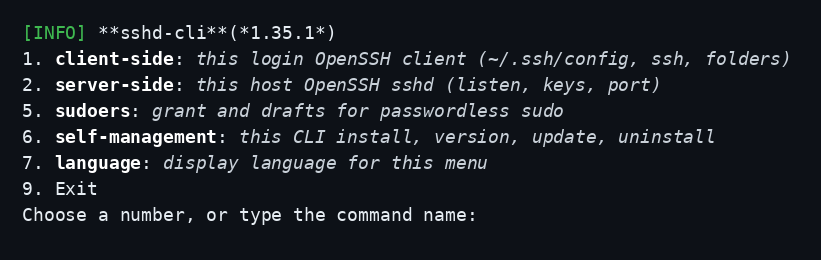

Termux / Git Bash / Windows cmd omit **5** and print why before the numbers (the label is `termux`, `gitbash`, or `windows-cmd`):

```text
[INFO] **sshd-cli**(*1.35.1*)
[INFO] sudoers not available for termux
1. **client-side**: *this login OpenSSH client (~/.ssh/config, ssh, folders)*
2. **server-side**: *this host OpenSSH sshd (listen, keys, port)*
6. **self-management**: *this CLI install, version, update, uninstall*
7. **language**: *display language for this menu*
9. Exit
Choose a number, or type the command name:
```

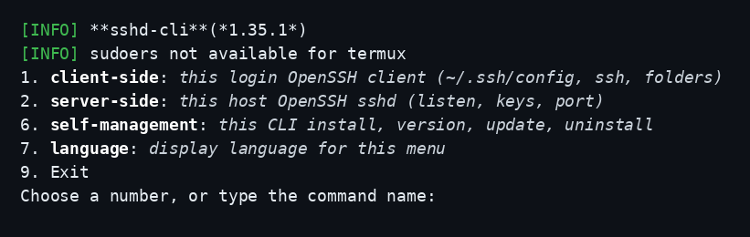

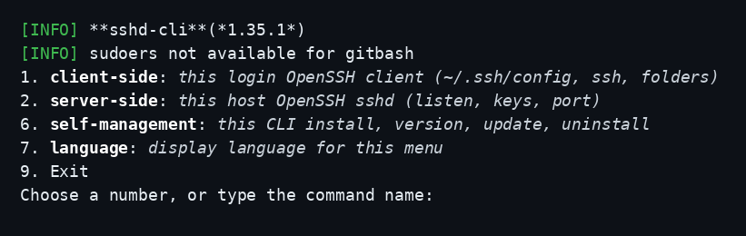

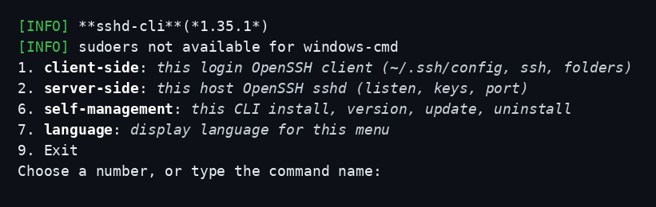

`7` opens language. Rows **70–89** are reserved for not more than 20 languages. **71** English, **72** 简体中文, **73** 繁體中文, **74** Español, **75** العربية, **76** Français, **77** Português, **78** Русский, **79** Deutsch, **80** 日本語, **81** 한국어, **82** Nederlands, **83** Ελληνικά. The choice is saved in `~/.local/sshd-cli/language` (one line, `en`, `zh-Hans`, `zh-Hant`, `es`, `ar`, `fr`, `pt`, `ru`, `de`, `ja`, `ko`, `nl`, or `el`) and the front board comes back in that language. `help` and `about` use the same language. **0** does not save. **70** and **84** through **89** are not printed. Front **8** is not a row.

```text
[INFO] **sshd-cli**(*1.35.1*) — language
71. **English**: *use English for this menu*
72. **简体中文**: *use Simplified Chinese for this menu*
73. **繁體中文**: *use Traditional Chinese for this menu*
74. **Español**: *use Spanish for this menu*
75. **العربية**: *use Arabic for this menu*
76. **Français**: *use French for this menu*
77. **Português**: *use Portuguese for this menu*
78. **Русский**: *use Russian for this menu*
79. **Deutsch**: *use German for this menu*
80. **日本語**: *use Japanese for this menu*
81. **한국어**: *use Korean for this menu*
82. **Nederlands**: *use Dutch for this menu*
83. **Ελληνικά**: *use Greek for this menu*
0. Back
Choose a number, or type the command name:
```

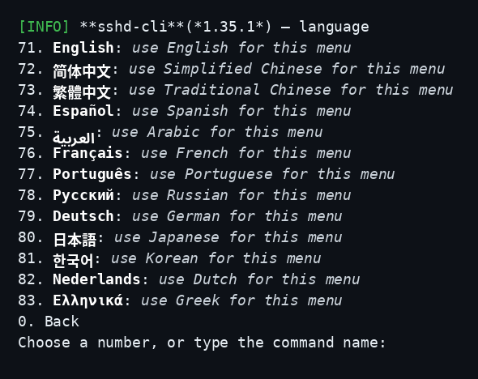

The front board, `help`, and `about` follow the saved language. Command names stay the words you type (`status`, `self-install`, `--json`).

After **72**, the front board is Simplified Chinese:

```text
[INFO] 菜单语言是简体中文
[INFO] **sshd-cli**(*1.35.1*)
1. **客户端**: *这个登录的 OpenSSH 客户端（~/.ssh/config、ssh、文件夹）*
2. **服务器端**: *这台主机的 OpenSSH sshd（监听、密钥、端口）*
5. **sudoers**: *免密码 sudo 的授权与草稿*
6. **自我管理**: *这个 CLI 的安装、版本、更新、移除*
7. **语言**: *这个菜单的显示语言*
9. 离开
请输入编号，或输入指令名称：
```

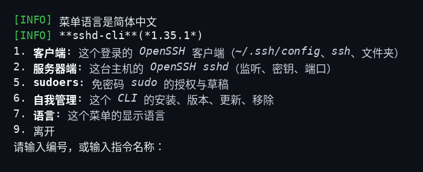

```text
[INFO] sshd-cli — 简化 Termux 安装 sshd
[INFO] 用法：
  sshd-cli [命令] [选项]
[INFO] === sshd-cli 1.35.1 - 关于 / 诊断 ===
[OK] sshd-cli 已正确安装。
```
After **73**, the front board is Traditional Chinese:

```text
[INFO] 選單語言是繁體中文
[INFO] **sshd-cli**(*1.35.1*)
1. **用戶端**: *這個登入的 OpenSSH 用戶端（~/.ssh/config、ssh、資料夾）*
2. **伺服器端**: *這台主機的 OpenSSH sshd（接聽、金鑰、連接埠）*
5. **sudoers**: *免密碼 sudo 的授權與草稿*
6. **自我管理**: *這個 CLI 的安裝、版本、更新、移除*
7. **語言**: *這個選單的顯示語言*
9. 離開
請輸入編號，或輸入指令名稱：
```

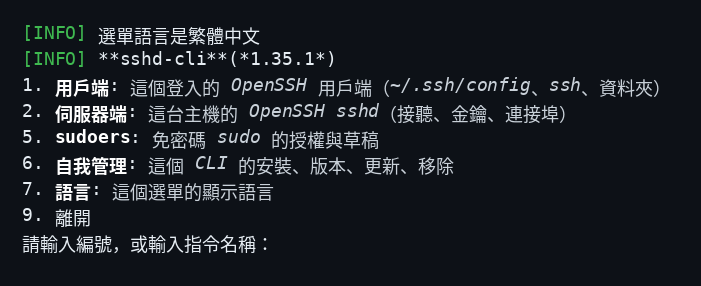

```text
[INFO] sshd-cli — 簡化 Termux 安裝 sshd
[INFO] 用法：
  sshd-cli [命令] [選項]
[INFO] === sshd-cli 1.35.1 - 關於 / 診斷 ===
[OK] sshd-cli 已正確安裝。
```
After **74**, the front board is Spanish:

```text
[INFO] El idioma del menú es español
[INFO] **sshd-cli**(*1.35.1*)
1. **cliente**: *cliente OpenSSH de este inicio (~/.ssh/config, ssh, carpetas)*
2. **servidor**: *sshd OpenSSH de este equipo (escucha, claves, puerto)*
5. **sudoers**: *concesión y borradores de sudo sin contraseña*
6. **autogestión**: *instalación, versión, actualización y desinstalación de este CLI*
7. **idioma**: *idioma de este menú*
9. Salir
Elija un número, o escriba el nombre del comando:
```

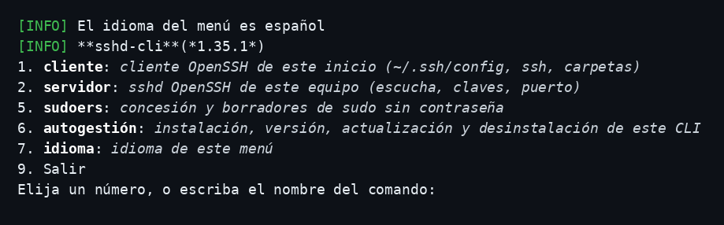

```text
[INFO] sshd-cli — simplificar la instalación de sshd en Termux
[INFO] Uso:
  sshd-cli [comando] [opciones]
[INFO] === sshd-cli 1.35.1 - Acerca de / diagnóstico ===
[OK] sshd-cli está instalado correctamente.
```
After **75**, the front board is Arabic:

```text
[INFO] لغة القائمة هي العربية
[INFO] **sshd-cli**(*1.35.1*)
1. **عميل**: *عميل OpenSSH لهذا الدخول (~/.ssh/config وssh والمجلدات)*
2. **خادم**: *sshd الخاص بـ OpenSSH على هذا الجهاز (الاستماع والمفاتيح والمنفذ)*
5. **sudoers**: *منح ومسودات sudo بلا كلمة مرور*
6. **إدارة-ذاتية**: *تثبيت هذا CLI وإصداره وتحديثه وإزالته*
7. **لغة**: *لغة العرض لهذه القائمة*
9. خروج
اختر رقما، أو اكتب اسم الأمر:
```

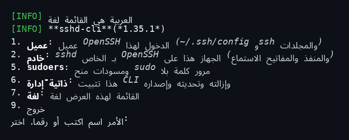

```text
[INFO] sshd-cli — تبسيط تثبيت sshd على Termux
[INFO] الاستخدام:
  sshd-cli [أمر] [خيارات]
[INFO] === sshd-cli 1.35.1 - حول / تشخيص ===
[OK] sshd-cli مثبت بشكل صحيح.
```
After **76**, the front board is French:

```text
[INFO] La langue du menu est le français
[INFO] **sshd-cli**(*1.35.1*)
1. **client**: *client OpenSSH de cette session (~/.ssh/config, ssh, dossiers)*
2. **serveur**: *sshd OpenSSH de cet hôte (écoute, clés, port)*
5. **sudoers**: *autorisation et brouillons pour sudo sans mot de passe*
6. **autogestion**: *installation, version, mise à jour et retrait de ce CLI*
7. **langue**: *langue d'affichage de ce menu*
9. Quitter
Choisissez un numéro, ou saisissez le nom de la commande :
```

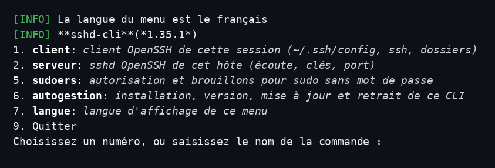

```text
[INFO] sshd-cli — simplifier l'installation de sshd sur Termux
[INFO] Utilisation :
  sshd-cli [commande] [options]
[INFO] === sshd-cli 1.35.1 - À propos / diagnostic ===
[OK] sshd-cli est correctement installé.
```
After **77**, the front board is Portuguese:

```text
[INFO] O idioma do menu é português
[INFO] **sshd-cli**(*1.35.1*)
1. **cliente**: *cliente OpenSSH deste login (~/.ssh/config, ssh, pastas)*
2. **servidor**: *sshd OpenSSH deste equipamento (escuta, chaves, porta)*
5. **sudoers**: *concessão e rascunhos de sudo sem senha*
6. **autogestão**: *instalação, versão, atualização e remoção deste CLI*
7. **idioma**: *idioma de exibição deste menu*
9. Sair
Escolha um número, ou escreva o nome do comando:
```

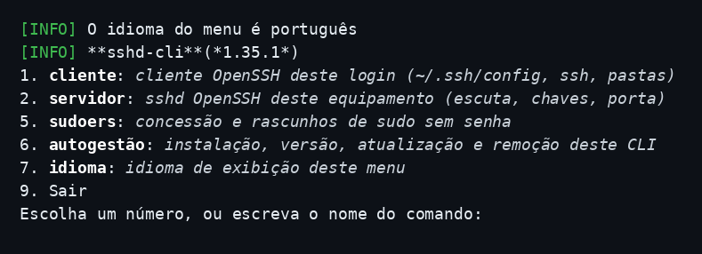

```text
[INFO] sshd-cli — simplificar a instalação de sshd no Termux
[INFO] Uso:
  sshd-cli [comando] [opções]
[INFO] === sshd-cli 1.35.1 - Acerca de / diagnóstico ===
[OK] sshd-cli está instalado corretamente.
```
After **78**, the front board is Russian:

```text
[INFO] Язык меню — русский
[INFO] **sshd-cli**(*1.35.1*)
1. **клиент**: *клиент OpenSSH этого входа (~/.ssh/config, ssh, папки)*
2. **сервер**: *sshd OpenSSH этого узла (прослушивание, ключи, порт)*
5. **sudoers**: *выдача и черновики sudo без пароля*
6. **самоуправление**: *установка, версия, обновление и удаление этого CLI*
7. **язык**: *язык отображения этого меню*
9. Выход
Выберите номер или введите имя команды:
```

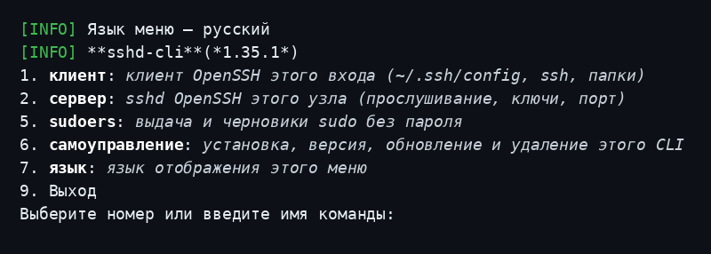

```text
[INFO] sshd-cli — упростить установку sshd в Termux
[INFO] Использование:
  sshd-cli [команда] [параметры]
[INFO] === sshd-cli 1.35.1 - О программе / диагностика ===
[OK] sshd-cli установлен правильно.
```
After **79**, the front board is German:

```text
[INFO] Die Menüsprache ist Deutsch
[INFO] **sshd-cli**(*1.35.1*)
1. **Client**: *OpenSSH-Client dieser Anmeldung (~/.ssh/config, ssh, Ordner)*
2. **Server**: *OpenSSH-sshd dieses Rechners (wartet, Schlüssel, Port)*
5. **sudoers**: *Freigabe und Entwürfe für sudo ohne Passwort*
6. **Selbstverwaltung**: *Installation, Version, Aktualisierung und Entfernen dieses CLI*
7. **Sprache**: *Anzeigesprache dieses Menüs*
9. Beenden
Wählen Sie eine Nummer, oder geben Sie den Befehlsnamen ein:
```

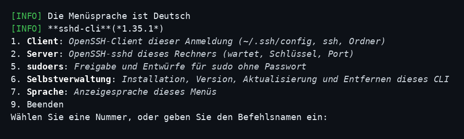

```text
[INFO] sshd-cli — sshd auf Termux einfach installieren
[INFO] Verwendung:
  sshd-cli [Befehl] [Optionen]
[INFO] === sshd-cli 1.35.1 - Über / Diagnose ===
[OK] sshd-cli ist ordnungsgemäß installiert.
```
After **80**, the front board is Japanese:

```text
[INFO] メニューの言語は日本語
[INFO] **sshd-cli**(*1.35.1*)
1. **クライアント**: *このログインの OpenSSH クライアント（~/.ssh/config、ssh、フォルダ）*
2. **サーバー**: *このホストの OpenSSH sshd（待ち受け、鍵、ポート）*
5. **sudoers**: *パスワードなし sudo の認可と下書き*
6. **自己管理**: *この CLI のインストール、バージョン、更新、削除*
7. **言語**: *このメニューの表示言語*
9. 終了
番号を入力するか、コマンド名を入力してください:
```

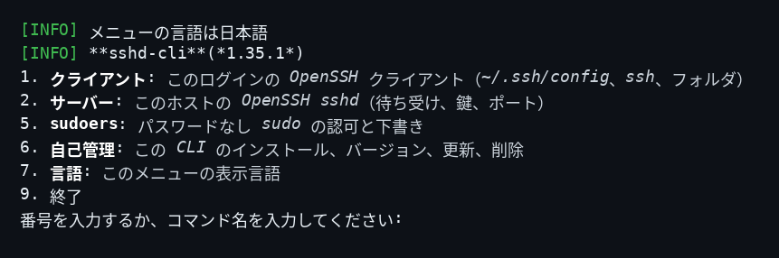

```text
[INFO] sshd-cli — Termux で sshd を簡単に導入する
[INFO] 使い方:
  sshd-cli [コマンド] [オプション]
[INFO] === sshd-cli 1.35.1 - 概要 / 診断 ===
[OK] sshd-cli は正しく配置されています。
```
After **81**, the front board is Korean:

```text
[INFO] 메뉴 언어는 한국어
[INFO] **sshd-cli**(*1.35.1*)
1. **클라이언트**: *이 로그인의 OpenSSH 클라이언트(~/.ssh/config, ssh, 폴더)*
2. **서버**: *이 호스트의 OpenSSH sshd(대기, 키, 포트)*
5. **sudoers**: *비밀번호 없는 sudo의 허가와 초안*
6. **자기관리**: *이 CLI의 설치, 버전, 업데이트, 제거*
7. **언어**: *이 메뉴의 표시 언어*
9. 종료
번호를 입력하거나 명령 이름을 입력하세요:
```

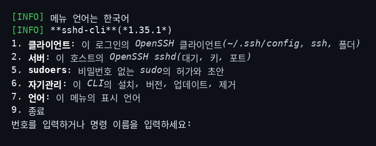

```text
[INFO] sshd-cli — Termux에서 sshd 설치를 단순하게
[INFO] 사용법:
  sshd-cli [명령] [옵션]
[INFO] === sshd-cli 1.35.1 - 개요 / 진단 ===
[OK] sshd-cli가 올바르게 설치되어 있습니다.
```
After **82**, the front board is Dutch:

```text
[INFO] De menutaal is Nederlands
[INFO] **sshd-cli**(*1.35.1*)
1. **client**: *OpenSSH-client van deze login (~/.ssh/config, ssh, mappen)*
2. **server**: *OpenSSH sshd van deze host (luisteren, sleutels, poort)*
5. **sudoers**: *toekenning en concepten voor sudo zonder wachtwoord*
6. **zelfbeheer**: *installatie, versie, update en verwijdering van deze CLI*
7. **taal**: *weergavetaal van dit menu*
9. Afsluiten
Kies een nummer, of typ de opdrachtnaam:
```

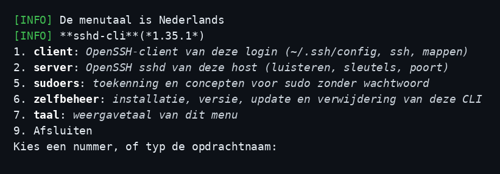

```text
[INFO] sshd-cli — sshd installeren op Termux vereenvoudigen
[INFO] Gebruik:
  sshd-cli [opdracht] [opties]
[INFO] === sshd-cli 1.35.1 - Over / diagnose ===
[OK] sshd-cli is correct geïnstalleerd.
```
After **83**, the front board is Greek:

```text
[INFO] Η γλώσσα του μενού είναι ελληνικά
[INFO] **sshd-cli**(*1.35.1*)
1. **πελάτης**: *πελάτης OpenSSH αυτής της σύνδεσης (~/.ssh/config, ssh, φάκελοι)*
2. **διακομιστής**: *sshd OpenSSH αυτού του υπολογιστή (ακρόαση, κλειδιά, θύρα)*
5. **sudoers**: *παραχώρηση και πρόχειρα για sudo χωρίς κωδικό*
6. **αυτοδιαχείριση**: *εγκατάσταση, έκδοση, ενημέρωση και αφαίρεση αυτού του CLI*
7. **γλώσσα**: *γλώσσα εμφάνισης αυτού του μενού*
9. Έξοδος
Επιλέξτε αριθμό ή πληκτρολογήστε το όνομα της εντολής:
```

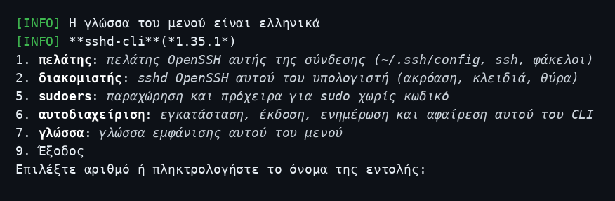

```text
[INFO] sshd-cli — απλοποίηση εγκατάστασης sshd στο Termux
[INFO] Χρήση:
  sshd-cli [εντολή] [επιλογές]
[INFO] === sshd-cli 1.35.1 - Σχετικά / διάγνωση ===
[OK] Το sshd-cli είναι σωστά εγκατεστημένο.
```

English `help` and `about` stay:

```text
[INFO] sshd-cli — Simplify Termux to install sshd
[INFO] Usage:
  sshd-cli [command] [options]
[INFO] === sshd-cli 1.35.1 - About / Diagnostics ===
[OK] sshd-cli is properly installed.
```

`5` opens sudoers (POSIX Linux). Termux / Git Bash / Windows cmd omit this row and print `[INFO] sudoers not available for termux` (or `gitbash` / `windows-cmd`) on the front board. The sudoers header is the program name only:

```text
[INFO] sshd-cli — sudoers (grant and drafts)
51. **generate-sudoer-request**: *Write a JSON grant you can read*
52. **submit-sudoer-request**: *Queue the JSON grant inbound*
53. **print-sudoers**: *Emit sudoers draft*
54. **print-sudoers-install-script**: *Write admin install script*
55. **remove-project-sudoers**: *Remove sudoers draft only*
0. Back
```

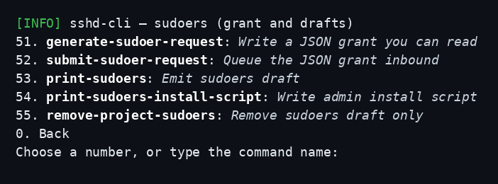

`1` opens client-side. POSIX Linux:

```text
[INFO] **sshd-cli**(*1.35.1*) — client-side
11. **dns**: *this login ~/.ssh/config Host list*
12. **ssh**: *OpenSSH client to a Host from this login ~/.ssh/config*
13. **download**: *tar.gz a remote folder into this directory*
14. **upload**: *tar.gz a local folder onto a Host (extract under that ssh user home)*
15. **backup-config**: *copy this login ~/.ssh/config to /var/sshd-cli*
16. **sync-config**: *copy /var/sshd-cli/config into this login ~/.ssh/config*
   (or type sync-from-remote [user@host]: copy /var/sshd-cli/config from another host)
0. Back
```

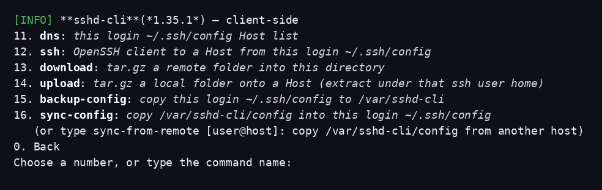

Termux / Git Bash / Windows cmd (no **15** / **16**; **18** is numbered):

```text
[INFO] **sshd-cli**(*1.35.1*) — client-side
[INFO] backup-config and sync-config not available for termux
11. **dns**: *this login ~/.ssh/config Host list*
12. **ssh**: *OpenSSH client to a Host from this login ~/.ssh/config*
13. **download**: *tar.gz a remote folder into this directory*
14. **upload**: *tar.gz a local folder onto a Host (extract under that ssh user home)*
18. **sync-from-remote**: *copy /var/sshd-cli/config from user@host (or host)*
0. Back
```

`11` opens dns (empty list shown; a saved Host prints on the line above the actions):

```text
[INFO] SSH names (dns) in ~/.ssh/config
    (empty)
111. **Edit**: *change this Host (dns, ip, user, Termux, identity, Old OpenSSH). Enter keeps the current value*
112. **Add**: *new Host in this login ~/.ssh/config*
113. **Delete**: *remove a Host*
114. **Unset**: *drop extra settings (user, port, …) — not dns or ip*
0. Back
```

`2` opens server-side. POSIX Linux non-root (the INFO line names this OS; example **Ubuntu**):

```text
[INFO] **sshd-cli**(*1.35.1*) — server-side
[INFO] start/stop/restart sshd features are not available for non-root in Ubuntu
21. **status**: *running, port, and paths*
0. Back
```

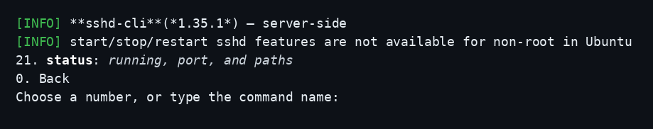

Termux (and a POSIX Linux **root** login) also shows **22–24**:

```text
[INFO] **sshd-cli**(*1.35.1*) — server-side
21. **status**: *running, port, and paths*
22. **start**: *launch the OpenSSH daemon (background, not a boot service)*
23. **stop**: *end the running daemon*
24. **restart**: *stop then start*
0. Back
```

`6` opens self-management:

```text
[INFO] **sshd-cli**(*1.35.1*) — self-management
61. **install**: *place sshd-cli; ensure rc + Termux openssh/termux-auth; start sshd*
62. **version**: *show version and detailed diagnostics (about)*
63. **about**: *show detailed diagnostics*
64. **version-check**: *compare local vs remote version*
65. **self-update**: *update sshd-cli to a newer remote version*
66. **self-uninstall**: *remove sshd-cli (safe PATH cleanup)*
67. **self-install**: *place this CLI only (copy this file, or download when piped)*
0. Back
```

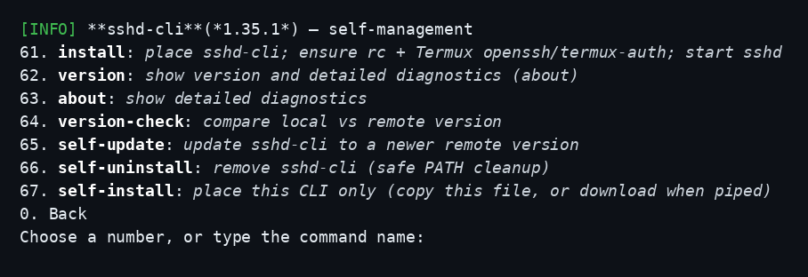

**0** goes back. After a command finishes, the **front board** is shown again (not the submenu). **9** on the front board leaves. A wrong number reprints **that** list.

## Usage

```sh
sshd-cli help
sshd-cli version
sshd-cli about
sshd-cli status
sshd-cli start
sshd-cli wake-lock
sshd-cli wake-unlock
sshd-cli stop
sshd-cli restart
sshd-cli port
sshd-cli port 8022
sshd-cli config
sshd-cli host-keys generate
sshd-cli auth-keys add ./laptop.pub
sshd-cli dns
sshd-cli dns list
sshd-cli dns show 1
sshd-cli dns set 1 ip 192.168.1.10 user "" port 8022
sshd-cli dns add dns phone ip 192.168.1.10 termux yes old-openssh yes
sshd-cli dns delete 1
sshd-cli dns unset 1 user
sshd-cli fix-config
sshd-cli fix-config --input-file "${HOME}/.ssh/config" --output-file "${HOME}/ssh-config.commented"
sshd-cli ssh
sshd-cli ssh 1
sshd-cli download
sshd-cli download phone /opt/app
sshd-cli download phone ~/box/app
sshd-cli upload
sshd-cli upload phone ./app
sshd-cli self-install
sshd-cli backup-config
sshd-cli sync-config
sshd-cli sync-from-remote
sshd-cli sync-from-remote user@host
sshd-cli menu
```

On Termux, `old-openssh yes` writes `HostKeyAlgorithms` and `PubkeyAcceptedAlgorithms` as comments (an active line makes that ssh client error). Menu **12** / `ssh` reads the Host stanza and, when those lines are comments, runs `ssh -o HostKeyAlgorithms=+ssh-rsa`.

Self-management (this login, no OS package manager): `self-install` (this file only), `install` (payload), `version-check`, `self-update`, `self-uninstall`.

Global flags: `--quiet` / `-q`, `--json`, `--debug`, `--force`. On a terminal, `--debug` or `--force` with no command opens the menu. `--quiet` or `--json` with no command places the CLI.

## Examples

```sh
# See whether sshd is running (Termux often listens on 8022)
sshd-cli status

# Start it (OpenSSH forks into the background), then connect from a laptop
sshd-cli start
ssh -p 8022 "$(id -un)"@192.0.2.10

# If Android dropped the wake lock (screen off killed Termux), acquire again
sshd-cli wake-lock

# Allow a laptop public key
sshd-cli auth-keys add ./laptop.pub

# After a reboot, start the daemon again (this CLI is not a boot service)
sshd-cli start

# Optional: Termux:Boot — you own ~/.termux/boot/; this CLI has no enable-service verb
mkdir -p ~/.termux/boot
printf '%s\n' 'sshd-cli start' > ~/.termux/boot/start-sshd
chmod +x ~/.termux/boot/start-sshd

# This login's SSH names (OpenSSH client ~/.ssh/config)
sshd-cli dns list
sshd-cli dns show 1
sshd-cli dns set 1 ip 192.168.1.10 user "" port 8022
sshd-cli dns add dns phone ip 192.168.1.10 termux yes old-openssh yes identity-file '~/.ssh/phone' identities-only yes
sshd-cli dns delete 1
sshd-cli dns unset 1 user
sshd-cli fix-config
sshd-cli ssh phone
sshd-cli download phone /opt/app
sshd-cli download phone ~/box/app
sshd-cli upload phone ./app
sshd-cli backup-config
sshd-cli sync-config
sshd-cli sync-from-remote user@host
```

`--json` prints machine objects (`sshd-cli --json status`).

## Platform Compatibility

| Platform | Status |
|----------|--------|
| Termux (Android, OpenSSH via `pkg install openssh`) | Primary target — this login only; no `sudo curl` |
| POSIX Linux with OpenSSH server | Supported; system sshd start/stop/port/host-keys need a **root login** |
| Git Bash / MSYS2 | Same “this login only” class as Termux: no `pkg`, no in-tool `sudo`. A gzip reader here does not take `download` or `upload` on stdin. From **1.35.1** the ship unit uses a finished file |
| Windows cmd | Same “this login only” class: no `pkg`, no in-tool `sudo`. Folder tar.gz keeps the streamed pipe. `Windows_NT` alone is not the MSYS ban |
| Windows OpenSSH (host) | Companion script: install sshd and allow a **normal (non-admin) user** to SSH in, with Git Bash or PowerShell as the session shell |
| Other UNIX with `/bin/sh`, `sha256sum`, `mktemp` | CLI install as this login should work; sshd paths follow POSIX defaults |

On **Termux**, `sshd-cli start` is a **background daemon for this session** (OpenSSH forks itself). Leaving the shell is fine. A reboot, or Android killing Termux, ends the daemon — run `start` again. `start` also acquires an Android wake lock so the CPU can stay awake with the screen off; if Android dropped it, run `sshd-cli wake-lock`. Listen-after-reboot is **Termux:Boot** (operator hook).

On a **Linux** server with a loaded distro unit (`ssh.service` or `sshd.service`), `sshd-cli start` / `stop` / `restart` as **root** call `systemctl` on that unit. Listen-after-reboot is the distro unit. There is no `sshd-cli systemctl` command and no in-tool `sudo`. Non-root logins fail closed: re-run as root.

### Windows OpenSSH (normal user + Git Bash)

Windows OpenSSH is **not** a `sshd-cli` verb. Use the companion script so a **non-admin** local user can SSH in (Administrators use a different authorized_keys file under ProgramData). The script is host setup: it self-elevates with UAC.

**PowerShell:**

```text
powershell.exe -NoProfile -ExecutionPolicy Bypass -File .\setup-windows-ssh-server.ps1
```

**Git Bash** (same folder):

```sh
./setup-windows-ssh-server.sh
# or:
powershell.exe -NoProfile -ExecutionPolicy Bypass -File "$(cygpath -w ./setup-windows-ssh-server.ps1)"
```

Named arguments (still UAC):

```text
powershell.exe -NoProfile -ExecutionPolicy Bypass -File .\setup-windows-ssh-server.ps1 -User sshuser -Shell GitBash -PublicKeyFile %USERPROFILE%\.ssh\id_ed25519.pub -SkipPause
```

`-Shell` is `GitBash` (Git for Windows `bash.exe`, not `git-bash.exe`), `PowerShell`, `Pwsh`, `Cmd`, or `Ask`. After setup, from Linux or another Git Bash: `ssh <user>@<windows-lan-ip>`.

On **Git Bash** (detect: `MSYSTEM` or `uname` MINGW/MSYS — not `$0=/bin/bash`, not `[ -d /c/ ]`), folder `download` and `upload` do not hand gzip to this shell on stdin. From **1.35.1** the archive is a finished file. A short sleep is not the repair. Native Windows console programs need **winpty**: `winpty grok`, `winpty powershell.exe`. Do not wrap `git` or piped/`--json` runs. `HOME` looking like `/c/…` is typical after detect, not the check.

## Related Projects

- [selfmanaged](https://github.com/cloudgen/selfmanaged) — bootstrap origin (install / self-update / self-uninstall as this login)
- [CIAO](https://github.com/cloudgen/ciao) — defensive programming philosophy
- [CIAO-Lite](https://github.com/cloudgen/ciao-lite) — agent contract

## Contributing

Keep CIAO Protection Zones. Do not reverse-copy this product onto `selfmanaged`. Run `./tests/run.sh` before claiming a change done. Product law lives under `docs/requirements/`.

## License

MIT. See [`LICENSE.md`](./LICENSE.md). Copyright (c) 2026 Cloudgen Wong.

## Last Update

2026-10-16 — README terminal screenshots of the numbered boards. 2026-10-16 — 1.35.1: an MSYS2 or Git Bash gzip reader gets a finished archive, an `scp` copy, a file extract, then removal of the archive. Other families keep the stream. `Windows_NT` keeps the stream. 2026-10-14 — requirements only (product stays 1.35.0): an MSYS2 or Git Bash gzip reader must not take `download` or `upload` on stdin. Finish the archive, copy the file, extract that file, then remove it. Other families keep the stream. That build still piped. 2026-10-14 — 1.35.0: missing sshd names `dnf` on Fedora and RHEL and `apt` on Debian and Ubuntu, and says this program does not run that command. Git Bash, Windows cmd, and macOS each have their own next step. Termux still uses `sshd-cli install`. 2026-10-14 — 1.34.0: front **5** sudoers (**51–55**), **6** self-management (**61–67**), **7** language (block **70–89**, assigned **71** English through **83** Greek). **70** and **84–89** are not printed. Front **8** is not a row. 2026-10-10 — 1.33.0: on Termux / Git Bash / Windows cmd the front board prints `[INFO] sudoers not available for termux` (or `gitbash` / `windows-cmd`) before the numbers and still omits **7**. 2026-10-02 — 1.32.0: menu **5** Language assigns **51** English, **52** 简体中文, **53** 繁體中文, then **54** Español through **63** Ελληνικά by native-speaker count. Adds العربية, Português, Русский, Nederlands, and Ελληνικά. **50** and **64–69** are not printed. Front **6** is not a row. 2026-10-02 — 1.31.0: menu **5** Language. Language rows **50–69** are reserved for not more than 20 languages. Assigned **51** English through **58** Korean. **50** and **59–69** are not printed. 2026-09-30 — 1.30.0: `fix-config` comments OpenSSH client keywords this OS does not support, and every run does that to `~/.ssh/config`. 2026-09-28 — 1.29.0: menu **6** Language saves English, 繁體中文, Español, Français, Deutsch, 简体中文, 日本語, or 한국어, and human `help` and `about` follow that language. 2026-09-28 — README shows the front board, `help`, and `about` in each menu language (English, 繁體中文, Español, Français, Deutsch, 简体中文, 日本語, 한국어). Product version stays 1.28.0. 2026-09-28 — Menu **6** Language also offers Japanese (日本語) and Korean (한국어). `help` and `about` follow that language. Product version stays 1.28.0. 2026-09-28 — Menu **6** Language also offers Spanish (Español), French (Français), German (Deutsch), and Simplified Chinese (简体中文), saved in `~/.local/sshd-cli/language`. Product version stays 1.28.0. 2026-09-28 — Menu **6** Language: English or Traditional Chinese (繁體中文), saved in `~/.local/sshd-cli/language`. Product version stays 1.28.0. 2026-09-28 — 1.28.0: on a terminal, no command opens the numbered menu, and a switch such as `--debug` is still no command. `--quiet` or `--json` with no command places the CLI. 2026-09-27 — 1.27.0: each login and each process gets its own cache folder (`cache-sshd-cli-<login>-<pid>` on `/dev/shm/cache` or `/tmp/cache`). `about` prints Cache folder used, preferred, 1st fallback, and 2nd fallback when this host has one. Git Bash has no 2nd fallback line. A skipped tier prints nothing. Durable data stays in `~/.local/sshd-cli`. 2026-09-27 — 1.26.0: on Termux, Old OpenSSH `HostKeyAlgorithms` / `PubkeyAcceptedAlgorithms` are comments; `ssh` (menu **12**) passes `-o HostKeyAlgorithms=+ssh-rsa` when that Host has those comments. 2026-09-27 — 1.25.0: TTY **sudoers** is front **7** (verbs **71** generate-sudoer-request, **72** submit-sudoer-request, **73** print-sudoers, **74** print-sudoers-install-script, **75** remove-project-sudoers). Client board no longer numbers it **17**. 2026-09-17 — 1.24.0: pipe / `self-install` places the CLI only (copy when you run the file; dest 0700 local). Payload stays `install`. 2026-09-17 — 1.23.0: preferred cache is `/dev/shm/cache/sshd-cli-<user>` (not `/dev/shm/sshd-cli-<user>`). 2026-09-16 — 1.22.0: after a finished TTY command the front board is shown again (not the submenu). 2026-09-14 — 1.20.0: TTY menu is a tree (1 client-side, 2 server-side, 8 self-management; children keep the parent number; 0 Back). 2026-09-13 — 1.19.2: a wrong TTY menu number warns and shows the same list again. 2026-09-12 — 1.19.1: `download` accepts `~/folder` (remote login home). 2026-09-12 — 1.19.0: TTY `download` asks user with default (same as `ssh`). 2026-09-12 — 1.18.0: TTY menu numbers `ssh` (6) and `download` (7); `ssh` asks user with default. 2026-09-12 — 1.17.0: `ssh` picks a Host from this login `~/.ssh/config`; `download` tar.gz a remote folder into the current directory (remembers paths per Host). 2026-09-12 — 1.16.0: `dns unset` drops extra `~/.ssh/config` settings (user, port, …) without deleting the Host or HostName. 2026-09-11 — 1.15.0: `sync-from-remote` pulls `/var/sshd-cli/config` via scp and remembers last user@host. 2026-09-11 — 1.14.0: `backup-config` / `sync-config` for this-login `~/.ssh/config` (`/var/sshd-cli`); sudoers grant `sudo sshd-cli backup-config`; Termux/Git Bash/Windows cmd hide + INFO. 2026-09-11 — 1.13.4: Git Bash `/dev/shm` mkdir fail-soft; use AppData Local Temp/`cache` with no extra `[ERROR]`. 2026-09-10 — 1.13.3: Windows companion `setup-windows-ssh-server.ps1` (+ Git Bash `.sh` launcher); Git Bash detect is `MSYSTEM`/`uname` (not `$0` or `/c/`); `winpty grok` for Windows consoles. 2026-09-09 — 1.13.2: dns tests mint Host/IP (do not copy this-login LAN identity). 1.13.1: `self-update` is CLI-only (does not fail on `/etc/ssh/sshd_config` / `/run/sshd`). 1.13.0: `rc-test` proves PATH/profile ensure in a temp folder; uninstall keeps a shared PATH while other tools remain.
